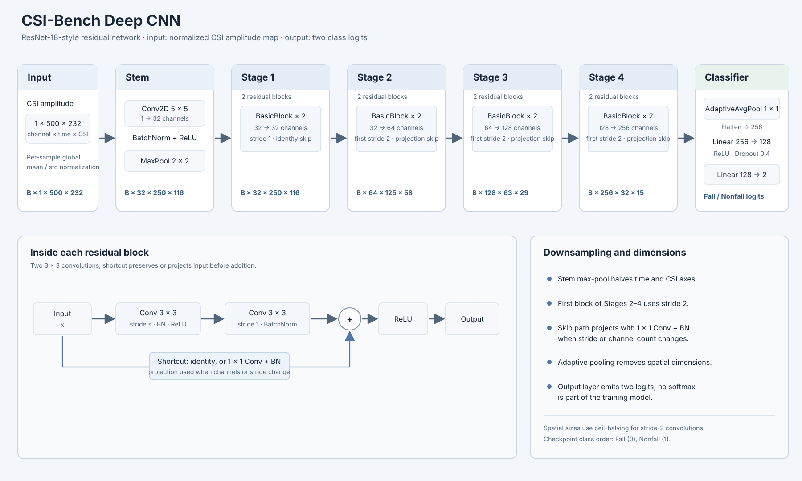

# WiFi CSI Fall Detection

Proof of concept for WiFi CSI fall detection using the WiFall dataset.

This repository has three separate stages:

1. WiFall-specific data loading and model training.
2. CSI-Bench HDF5 loading and CNN training.
3. Generic model validation and static HTML reporting.

The HTML report does not depend on WiFall, CSI-Bench, WiFi CSI, or a specific model. Any compatible classification model can produce an evaluation result artifact for the same renderer.

## Requirements

- Python 3.12 or newer
- `uv`
- macOS, Linux, or Windows

Install project dependencies:

```bash
uv sync
```

Run commands from repository root.

## Train a CNN on CSI-Bench

The [CSI-Bench benchmark](https://github.com/guozhen-jenn-zhu/CSI-Bench-Real-WiFi-Sensing-Benchmark) provides task folders with `metadata/sample_metadata.csv`, `metadata/label_mapping.json`, official ID lists under `splits/`, and per-sample HDF5 files. This repository's default task is `FallDetection`; its `train_id.json`, `val_id.json`, and `test_id.json` are used as provided. HDF5 samples use `CSI_amps` with shape `(232, 500, 1)`. The loader normalizes each sample and feeds CNN tensors shaped `(1, 500, 232)`. Model uses an 18-layer residual CNN, up to 100 epochs, and validation-loss learning-rate reduction/early stopping.

Train from the repository root:

```bash
uv run python -m csi_bench.cnn data/raw/csi-bench \
  --task FallDetection \
  --output-dir data/processed/csi-bench/cnn
```

Outputs: `csi-bench-cnn.pt` (best validation macro-F1 checkpoint), `run.json`, and self-contained `report.html` with loss curves and held-out test confusion matrix. Use `--task` to select another CSI-Bench supervised task with the same metadata/split/HDF5 layout. `RawContinuousRecording` is a separate raw capture collection and is not consumed by this loader.



The existing baseline checkpoint and metrics are in `data/processed/csi-bench/cnn/`; its recorded config uses official splits, seed 42, and the defaults below. No baseline retraining needed unless checkpoint/config differs on your machine. Train the CNN+LSTM model with matching settings:

```bash
uv run python -m csi_bench.cnn_lstm data/raw/csi-bench \
  --task FallDetection \
  --output-dir data/processed/csi-bench/cnn-lstm \
  --hidden-size 64
```

The LSTM receives 32 chronologically ordered CNN feature vectors per sample. Its regularized architecture applies spatial dropout inside residual blocks plus sequence and classifier-head dropout; AdamW uses weight decay `1e-3` by default. `ReduceLROnPlateau` already schedules learning rate from validation loss. Use `--user-split path/to/users.json` to assign `train_id`, `val_id`, and `test_id` user lists from JSON. It saves checkpoint, metrics, and held-out confusion-matrix report. Compare test results only after model selection is complete on validation. If baseline artifacts are unavailable or use different settings, retrain baseline with `python -m csi_bench.cnn` and a separate output directory.

Train the CSI-Bench Random Forest baseline using its official splits:

```bash
uv run python -m csi_bench.random_forest data/raw/csi-bench \
  --task FallDetection \
  --output-dir data/processed/csi-bench/random-forest
```

It extracts robust-normalized temporal statistics, then saves `csi-bench-random-forest.joblib`, `run.json`, and self-contained `report.html` with the held-out test confusion matrix and training/validation log-loss curves. Validation metrics are reported without tuning; final metrics use the official test split.

Evaluate that trained CSI-Bench forest as two separate zero-shot tests on ENetFall and WiFall held-out test data:

```bash
uv run python -m csi_bench.evaluate_external \
  --model data/processed/csi-bench/random-forest/csi-bench-random-forest.joblib \
  --enetfall-root data/raw/ENetFall \
  --wifall-root data/raw/wifall/WiFall \
  --wifall-split data/processed/wifall/split.json \
  --output-dir data/processed/csi-bench/external-random-forest
```

Creates per-dataset `run.json` and detailed reports plus one combined `report.html` with both metric summaries and confusion matrices. Add `--all-data` to evaluate every ENetFall event and WiFall recording, including records in source train/validation partitions. This is zero-shot evaluation: each source is index-interpolated to CSI-Bench's 500 × 232 input shape, an approximate feature alignment that makes results exploratory rather than directly comparable to in-domain CSI-Bench metrics.

Run the same full-dataset evaluation with the trained CSI-Bench CNN:

```bash
uv run python -m csi_bench.evaluate_external_cnn --all-data
```

Outputs go to `data/processed/csi-bench/external-cnn/`, separate from the Random Forest report. Combine standard and user-split cross-dataset results, executive ranking, confusion matrices, and inline neural-network diagrams with:

```bash
uv run python -m csi_bench.cross_dataset_report
```

The combined report is `data/processed/csi-bench/cross-dataset-comparison/report.html`. Best-model ranking uses equal-weight mean balanced accuracy across ENetFall and WiFall.

## 1. Download WiFall

Raw datasets are ignored by Git. Download WiFall only when `data/raw/wifall/WiFall/` does not exist:

```bash
mkdir -p data/raw/wifall
curl -L --fail --retry 3 \
  --output data/raw/wifall/WiFall.zip \
  'https://huggingface.co/datasets/RS2002/WiFall/resolve/main/WiFall.zip'
unzip -q data/raw/wifall/WiFall.zip -d data/raw/wifall
```

Expected layout:

```text
data/raw/wifall/WiFall/
├── ID0/
│   ├── fall/
│   ├── Jump/
│   ├── sit/
│   ├── stand/
│   └── walk/
└── ID9/
```

## 2. Validate the dataset

Run dataset validation and print counts:

```bash
uv run python -m wifall.cli summarize data/raw/wifall/WiFall
```

Expected WiFall counts:

```text
10 participants
928 recordings
232,941 CSI rows
```

The loader parses each 104-value CSI array into 52 complex subcarriers. It preserves participant and activity metadata and creates `fall` or `non-fall` targets.

## 3. Create participant-held-out splits

Create output directories and a deterministic split manifest:

```bash
mkdir -p data/processed/wifall
uv run python -m wifall.cli split \
  data/raw/wifall/WiFall \
  data/processed/wifall/split.json \
  --seed 42 \
  --test-participants 2 \
  --validation-participants 1
```

The default split contains:

- Training participants: 7
- Validation participants: 1
- Test participants: 2

Complete participants stay in one split. This prevents participant leakage.

## 4. Persist causal consecutive CSI windows

Assign participants to splits first, then create chronological windows inside each recording. Windows never cross recording boundaries and use only observed current and past rows:

```bash
uv run python -m wifall.cli preprocess-causal-windows \
  data/raw/wifall/WiFall \
  data/processed/wifall/split.json \
  data/processed/wifall/causal-windows-v1 \
  --window-samples 32 \
  --stride-samples 4
```

Outputs:

```text
data/processed/wifall/causal-windows-v1/
├── data.npz
└── metadata.json
```

`data.npz` stores raw CSI amplitude windows shaped as `window × samples × subcarrier`. Window labels inherit recording labels and are weak labels because WiFall does not mark exact fall onset. Metadata stores source recording IDs, participants, timestamps, boundaries, counts, and causal window configuration.

Training commands consume raw recordings directly. The persisted window artifact provides an auditable causal data view.

## 5. Train and evaluate the WiFall SVM

Train the baseline and write its model plus generic evaluation result:

```bash
uv run python -m wifall.cli train-svm \
  data/raw/wifall/WiFall \
  data/processed/wifall/split.json \
  data/processed/wifall/svm-run
```

Outputs:

```text
data/processed/wifall/svm-run/
├── model.joblib
└── run.json
```

`model.joblib` contains the CSI feature extraction, `StandardScaler`, and SVM pipeline.

`run.json` contains the model-agnostic evaluation result:

- True labels and predicted labels
- Optional decision scores
- Confusion matrix
- Accuracy and balanced accuracy
- Precision, recall, sensitivity, specificity, F1
- False-positive rate
- Macro and weighted metrics
- Optional ROC-AUC and PR-AUC
- Dataset, task, model, feature, preprocessing, and split metadata

Training does not fit or refit on validation or test data.

## 6. Train the improved WiFall SVM

Run separate improved SVM training. This does not overwrite the baseline model or result.

```bash
uv run python -m wifall.cli train-improved-svm \
  data/raw/wifall/WiFall \
  data/processed/wifall/split.json \
  data/processed/wifall/improved-svm-run
```

Outputs:

```text
data/processed/wifall/improved-svm-run/
├── dataset_audit.json
├── model.joblib
├── report.html
└── run.json
```

The improved pipeline adds:

- Per-recording CSI amplitude normalization
- Temporal window features
- Participant-grouped SVM selection
- Positive-class score orientation
- Validation threshold selection
- Per-participant metrics
- Score distributions and threshold metrics

`run.json` and `report.html` are generated by training command. Open `report.html` directly after training.

## 7. Train the separate WiFall Random Forest

Train Random Forest with the same improved normalized temporal features and participant-held-out split:

```bash
uv run python -m wifall.cli train-random-forest \
  data/raw/wifall/WiFall \
  data/processed/wifall/split.json \
  data/processed/wifall/random-forest-run
```

Outputs:

```text
data/processed/wifall/random-forest-run/
├── dataset_audit.json
├── model.joblib
├── report.html
└── run.json
```

Random Forest parameters are selected from a regularized search, and fall scores are sigmoid-calibrated before threshold selection. Feature selection compares the four-window baseline with an eight-window motion representation containing delta magnitude, slope, energy, peak-to-peak, and change-point features. Leave-one-participant-out validation covers training and validation participants with equal participant contribution. Test participants are evaluated once for final aggregate and per-participant metrics.

## 8. Train simple MLP

Train a small regularized MLP on fixed-size normalized temporal CSI features. The MLP uses participant-grouped non-test validation and safety-oriented minimum-recall threshold selection.

```bash
uv run python -m wifall.cli train-mlp \
  data/raw/wifall/WiFall \
  data/processed/wifall/split.json \
  data/processed/wifall/mlp-run
```

Outputs include `model.joblib`, `run.json`, `dataset_audit.json`, and self-contained `report.html`.

## 9. Train simple CNN

Train a small 2D CNN on normalized CSI amplitude tensors shaped as `channel × time × subcarrier`. The CNN uses participant-grouped non-test validation and safety-oriented minimum-recall threshold selection.

Install project dependencies with `uv sync`, then run:

```bash
uv run python -m wifall.cli train-cnn \
  data/raw/wifall/WiFall \
  data/processed/wifall/split.json \
  data/processed/wifall/cnn-run
```

Outputs include `model.joblib`, `run.json`, `dataset_audit.json`, and self-contained `report.html`.

## 10. Train causal LSTM on raw CSI windows

Train a participant-held-out LSTM directly from raw chronological recordings. Architecture and threshold selection use grouped non-test validation; test participants remain held out until final evaluation:

```bash
uv run python -m wifall.cli train-lstm \
  data/raw/wifall/WiFall \
  data/processed/wifall/split.json \
  data/processed/wifall/lstm-causal-run \
  --causal-window-dataset data/processed/wifall/causal-windows-v1 \
  --causal-window 32 \
  --window-stride 4 \
  --hidden-size 32 \
  --layer-count 1 \
  --dropout 0.1 \
  --epochs 20 \
  --batch-size 32 \
  --seed 42
```

Each input window contains consecutive raw CSI rows. LSTM inference uses only current and past samples, resets its stateless window at each recording or stream session, and records weak-label limitations. Outputs include `model.joblib`, `run.json`, `dataset_audit.json`, and self-contained `report.html`.

Analyze LSTM against compatible raw-CSI CNN, improved SVM, and Random Forest runs:

```bash
uv run python -m wifall.cli analyze-lstm \
  data/processed/wifall/lstm-analysis \
  data/processed/wifall/lstm-causal-run \
  data/processed/wifall/cnn-run \
  data/processed/wifall/improved-svm-run \
  data/processed/wifall/random-forest-run
```

The analysis reports validation and held-out test metrics, per-participant failures, error overlap, complementarity, validation-only operating points, and an adopt/investigate/reject recommendation.

## 11. Blend improved SVM and Random Forest

Create calibrated ensemble scores. Calibration fits use train and validation artifacts; blend weight and threshold use grouped validation only. Test participants are evaluated after selection.

```bash
uv run python -m wifall.cli train-ensemble \
  data/raw/wifall/WiFall \
  data/processed/wifall/split.json \
  data/processed/wifall/improved-svm-run \
  data/processed/wifall/random-forest-run \
  data/processed/wifall/ensemble-run
```

Outputs include `run.json` and self-contained `report.html`. Compare ensemble with source runs:

```bash
uv run python -m evaluation.comparison \
  data/processed/wifall/comparison/report.html \
  data/processed/wifall/svm-run/run.json \
  data/processed/wifall/improved-svm-run/run.json \
  data/processed/wifall/random-forest-run/run.json \
  data/processed/wifall/ensemble-run/run.json
```

## 12. Generate static HTML report

Render the JSON evaluation result as self-contained HTML:

```bash
uv run python -m evaluation.cli \
  data/processed/wifall/svm-run/run.json \
  data/processed/wifall/svm-run/report.html
```

Equivalent installed command:

```bash
evaluation-report \
  data/processed/wifall/svm-run/run.json \
  data/processed/wifall/svm-run/report.html
```

## 13. View the report

On macOS:

```bash
open data/processed/wifall/svm-run/report.html
```

On Linux:

```bash
xdg-open data/processed/wifall/svm-run/report.html
```

On Windows PowerShell:

```powershell
Start-Process data/processed/wifall/svm-run/report.html
```

The report shows:

- Dataset, task, model, feature, preprocessing, and split metadata
- Confusion matrix counts and row percentages
- Overall metrics
- Per-class metrics
- Macro and weighted averages
- Binary fall-detection metrics
- ROC-AUC and PR-AUC when compatible scores exist
- `Not available` for optional metrics that cannot be calculated

## 14. Compare model runs

Generate one offline comparison report from any valid generic run artifacts:

```bash
uv run python -m evaluation.comparison \
  data/processed/wifall/comparison/report.html \
  data/processed/wifall/svm-run/run.json \
  data/processed/wifall/improved-svm-run/run.json \
  data/processed/wifall/random-forest-run/run.json \
  data/processed/wifall/mlp-run/run.json \
  data/processed/wifall/cnn-run/run.json \
  data/processed/wifall/ensemble-run/run.json
```

The comparison report links each run's individual report, compares metrics and metadata, and warns when labels, tasks, datasets, or evaluation protocols differ. Future model families only need valid generic run artifacts.

## 15. Analyze CNN complementarity

Analyze CNN errors, validation operating points, and complementary detections without selecting from test results:

```bash
uv run python -m wifall.cli analyze-cnn \
  data/processed/wifall/cnn-analysis \
  data/processed/wifall/cnn-run \
  data/processed/wifall/improved-svm-run \
  data/processed/wifall/random-forest-run \
  data/processed/wifall/ensemble-run
```

Outputs: `cnn-analysis.json` and self-contained `report.html`.

## Full command sequence

Run this sequence from repository root:

```bash
uv sync

uv run python -m wifall.cli summarize data/raw/wifall/WiFall

mkdir -p data/processed/wifall
uv run python -m wifall.cli split \
  data/raw/wifall/WiFall \
  data/processed/wifall/split.json

uv run python -m wifall.cli preprocess-causal-windows \
  data/raw/wifall/WiFall \
  data/processed/wifall/split.json \
  data/processed/wifall/causal-windows-v1

uv run python -m wifall.cli train-svm \
  data/raw/wifall/WiFall \
  data/processed/wifall/split.json \
  data/processed/wifall/svm-run

uv run python -m evaluation.cli \
  data/processed/wifall/svm-run/run.json \
  data/processed/wifall/svm-run/report.html

uv run python -m wifall.cli train-improved-svm \
  data/raw/wifall/WiFall \
  data/processed/wifall/split.json \
  data/processed/wifall/improved-svm-run

uv run python -m wifall.cli train-random-forest \
  data/raw/wifall/WiFall \
  data/processed/wifall/split.json \
  data/processed/wifall/random-forest-run

uv run python -m wifall.cli train-mlp \
  data/raw/wifall/WiFall \
  data/processed/wifall/split.json \
  data/processed/wifall/mlp-run

uv run python -m wifall.cli train-cnn \
  data/raw/wifall/WiFall \
  data/processed/wifall/split.json \
  data/processed/wifall/cnn-run

uv run python -m wifall.cli train-lstm \
  data/raw/wifall/WiFall \
  data/processed/wifall/split.json \
  data/processed/wifall/lstm-causal-run

uv run python -m wifall.cli analyze-lstm \
  data/processed/wifall/lstm-analysis \
  data/processed/wifall/lstm-causal-run \
  data/processed/wifall/cnn-run \
  data/processed/wifall/improved-svm-run \
  data/processed/wifall/random-forest-run

uv run python -m wifall.cli train-ensemble \
  data/raw/wifall/WiFall \
  data/processed/wifall/split.json \
  data/processed/wifall/improved-svm-run \
  data/processed/wifall/random-forest-run \
  data/processed/wifall/ensemble-run

uv run python -m evaluation.comparison \
  data/processed/wifall/comparison/report.html \
  data/processed/wifall/svm-run/run.json \
  data/processed/wifall/improved-svm-run/run.json \
  data/processed/wifall/random-forest-run/run.json \
  data/processed/wifall/mlp-run/run.json \
  data/processed/wifall/cnn-run/run.json \
  data/processed/wifall/ensemble-run/run.json

uv run python -m wifall.cli analyze-cnn \
  data/processed/wifall/cnn-analysis \
  data/processed/wifall/cnn-run \
  data/processed/wifall/improved-svm-run \
  data/processed/wifall/random-forest-run \
  data/processed/wifall/ensemble-run

open data/processed/wifall/svm-run/report.html
open data/processed/wifall/improved-svm-run/report.html
open data/processed/wifall/random-forest-run/report.html
open data/processed/wifall/mlp-run/report.html
open data/processed/wifall/cnn-run/report.html
open data/processed/wifall/lstm-causal-run/report.html
open data/processed/wifall/lstm-analysis/report.html
open data/processed/wifall/ensemble-run/report.html
open data/processed/wifall/comparison/report.html
```

## Generic evaluation flow

The report does not require the WiFall SVM. Another classification model can call the generic validator with:

```text
model + validation features + validation labels
    → evaluation result JSON
    → evaluation HTML report
```

The result artifact must follow the schema produced by `evaluation.evaluate_classifier`. The renderer only reads this artifact. It does not import the model or dataset implementation.

Optional hard-example diagnostics use the same model-independent artifact. Call `evaluation.analyze_hard_examples` with one evaluation and aligned observation metadata (`observation_id`, optional `group_id`, activity, duration, and signal-quality fields). Training pipelines persist diagnostics under `evaluations.<split>.hard_example_analysis`; diagnostics explain finalized errors but never select models, features, or thresholds.

## Tests

Run the full test suite:

```bash
uv run pytest
```

Run lint checks:

```bash
uv run ruff check csi_bench evaluation wifall tests pyproject.toml
```
